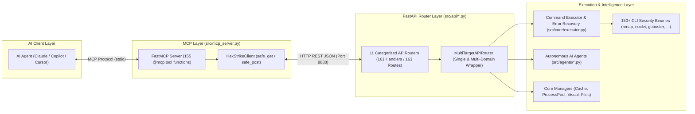

# HexStrike AI v6.0 — Tools & Endpoints Reference

This document explains how **MCP Tools** (`src/mcp_server.py`), **FastAPI Endpoints** (`src/api/*.py`), **AI Agents** (`src/agents/*.py`), and **Underlying CLI Security Tools / Core Engines** (`src/core/*.py`) are connected across the HexStrike AI platform.

---

## Table of Contents

1. [Architecture & Connection Flow](#1-architecture--connection-flow)
2. [Single-Domain & Multi-Domain Dispatch](#2-single-domain--multi-domain-dispatch)
3. [Summary by API Router Module](#3-summary-by-api-router-module)
4. [Category 1: Single & Multi-Domain Investigation (`src/api/investigation.py`)](#4-category-1-single--multi-domain-investigation-srcapiinvestigationpy)
5. [Category 2: Network Reconnaissance & Scanning (`src/api/network.py`)](#5-category-2-network-reconnaissance--scanning-srcapinetworkpy)
6. [Category 3: Web Application Security Testing (`src/api/web.py`)](#6-category-3-web-application-security-testing-srcapiwebpy)
7. [Category 4: Authentication & Password Security (`src/api/auth.py`)](#7-category-4-authentication--password-security-srcapiauthpy)
8. [Category 5: Binary Analysis & Reverse Engineering (`src/api/binary.py`)](#8-category-5-binary-analysis--reverse-engineering-srcapibinarypy)
9. [Category 6: Cloud & Container Security (`src/api/cloud.py`)](#9-category-6-cloud--container-security-srcapicloudpy)
10. [Category 7: CTF & Forensics Tools (`src/api/ctf_forensics.py`)](#10-category-7-ctf--forensics-tools-srcapictf_forensicspy)
11. [Category 8: Bug Bounty & OSINT Arsenal (`src/api/bugbounty_osint.py`)](#11-category-8-bug-bounty--osint-arsenal-srcapibugbounty_osintpy)
12. [Category 9: AI Intelligence & Vulnerability Intelligence (`src/api/intelligence.py`)](#12-category-9-ai-intelligence--vulnerability-intelligence-srcapiintelligencepy)
13. [Category 10: Process Management (`src/api/processes.py`)](#13-category-10-process-management-srcapiprocessespy)
14. [Category 11: Core System, Cache, Files & Visual Engine (`src/api/system.py`)](#14-category-11-core-system-cache-files--visual-engine-srcapisystempy)
15. [Composite & Multi-Endpoint MCP Tools (`src/mcp_server.py`)](#15-composite--multi-endpoint-mcp-tools-srcmcp_serverpy)

---

## 1. Architecture & Connection Flow

HexStrike AI connects AI agents (Claude, GPT, Copilot, Cursor, etc.) to system security tools and internal autonomous engines through a three-layer architecture:

### How a Tool Call Travels Through the System

1. **MCP Tool Invocation**: An AI agent calls an `@mcp.tool()` function in `src/mcp_server.py` (for example, `nmap_scan(target="example.com")`).
2. **HTTP Dispatch**: `HexStrikeClient` sends a `POST` or `GET` request to the corresponding FastAPI endpoint (for example, `POST /api/tools/nmap`).
3. **Target Normalization & Multi-Domain Routing**: `MultiTargetAPIRouter` (`src/core/domain_utils.py`) inspects the request payload. If multiple domains/targets are supplied, it dispatches the handler concurrently across a `ThreadPoolExecutor` and aggregates per-target results.
4. **Backend Execution**:
   - **CLI Tool Endpoints (`/api/tools/*`)** build the command line and run it through `execute_command()` or `execute_command_with_recovery()` (`src/core/executor.py`), utilizing smart caching (`HexStrikeCache`) and automatic failure recovery (`IntelligentErrorHandler`).
   - **Workflow & Intelligence Endpoints (`/api/investigation/*`, `/api/intelligence/*`, `/api/vuln-intel/*`, `/api/bugbounty/*`, `/api/ctf/*`, `/api/ai/*`)** invoke specialized AI agents in `src/agents/` (`DomainInvestigationManager`, `IntelligentDecisionEngine`, `BugBountyWorkflowManager`, `CTFWorkflowManager`, `CVEIntelligenceManager`, `AIExploitGenerator`, `VulnerabilityCorrelator`, `ContextualPayloadGenerator`).
   - **System & Process Endpoints (`/health`, `/api/processes/*`, `/api/process/*`, `/api/files/*`, `/api/visual/*`, `/api/error-handling/*`)** interact with core managers in `src/core/`.

---

## 2. Single-Domain & Multi-Domain Dispatch

All `POST` endpoints registered on a `MultiTargetAPIRouter` automatically support both **single-target** and **multi-target** execution (`src/core/domain_utils.py`):

| Payload Key Type | Accepted Keys | Input Formats Supported | Behavior |
| :--- | :--- | :--- | :--- |
| **Singular Keys** | `domain`, `target`, `url`, `target_url` | Single string (`"example.com"`), comma/newline-separated string (`"a.com,b.com"`), or JSON list (`["a.com", "b.com"]`) | Single target returns legacy response format; multiple targets trigger parallel multi-target execution. |
| **Plural Keys** | `domains`, `targets`, `urls`, `target_urls` | Single string, comma/newline-separated string, or JSON list | Automatically normalizes targets and runs in multi-domain mode (`parallel=True`, `max_workers=5` by default). |

---

## 3. Summary by API Router Module

| # | Router Module | OpenAPI Tag / Category | HTTP Routes | Connected MCP Tools | Primary Backend Tools / Engines                                                                                                                                                                                                                                                                                                                    |
| :-: | :--- | :--- | :-: | :-: |:---------------------------------------------------------------------------------------------------------------------------------------------------------------------------------------------------------------------------------------------------------------------------------------------------------------------------------------------------|
| 1 | [`src/api/investigation.py`](../src/api/investigation.py) | Single & Multi-Domain Investigation | 5 (4 handlers) | 4 | `DomainInvestigationManager`, `IntelligentDecisionEngine`, `BugBountyWorkflowManager`, 21 live CLI tool executors                                                                                                                                                                                                                                  |
| 2 | [`src/api/network.py`](../src/api/network.py) | Network Reconnaissance & Scanning | 17 | 18 | `nmap`, `rustscan`, `masscan`, `autorecon`, `amass`, `subfinder`, `fierce`, `dnsenum`, `arp-scan`, `nbtscan`, `rpcclient`, `enum4linux`, `enum4linux-ng`, `smbmap`, `responder`, `nxc`                                                                                                                                                             |
| 3 | [`src/api/web.py`](../src/api/web.py) | Web Application Security Testing | 35 | 42 | `gobuster`, `dirsearch`, `feroxbuster`, `ffuf`, `dirb`, `httpx`, `katana`, `hakrawler`, `gau`, `waybackurls`, ` `, `nikto`, `sqlmap`, `wpscan`, `arjun`, `paramspider`, `x8`, `jaeles`, `dalfox`, `wafw00f`, `zaproxy`, `wfuzz`, `dotdotpwn`, `xsser`, `anew`, `qsreplace`, `uro`, `HTTPTestingFramework`, `BrowserAgent`, `curl`, `burpsuite` |
| 4 | [`src/api/auth.py`](../src/api/auth.py) | Authentication & Password Security | 4 | 4 | `hydra`, `john`, `hashcat`, `hashpump`                                                                                                                                                                                                                                                                                                             |
| 5 | [`src/api/binary.py`](../src/api/binary.py) | Binary Analysis & Reverse Engineering | 18 | 18 | `gdb`, `peda`, `r2` (Radare2), `analyzeHeadless` (Ghidra), `binwalk`, `ROPgadget`, `ropper`, `one_gadget`, `checksec`, `strings`, `objdump`, `xxd`, `pwntools`, `angr`, `libc-database`, `pwninit`, `msfvenom`, `msfconsole`                                                                                                                       |
| 6 | [`src/api/cloud.py`](../src/api/cloud.py) | Cloud & Container Security | 12 | 12 | `prowler`, `scout` (Scout Suite), `cloudmapper`, `pacu`, `trivy`, `clairctl`, `kube-hunter`, `kube-bench`, `docker-bench-security`, `falco`, `checkov`, `terrascan`                                                                                                                                                                                |
| 7 | [`src/api/ctf_forensics.py`](../src/api/ctf_forensics.py) | CTF & Forensics Tools | 12 | 5 | `volatility`, `vol.py` (Volatility3), `foremost`, `steghide`, `exiftool`, `binwalk`, `zsteg`, `outguess`, `strings`, `checksec`, `ROPgadget`, `objdump`, `CTFWorkflowManager`, `CTFChallengeAutomator`, `CTFTeamCoordinator`, `CTFToolManager`                                                                                                     |
| 8 | [`src/api/bugbounty_osint.py`](../src/api/bugbounty_osint.py) | Bug Bounty & OSINT Arsenal | 6 | 6 (+1 local) | `BugBountyWorkflowManager`, `FileUploadTestingFramework`                                                                                                                                                                                                                                                                                           |
| 9 | [`src/api/intelligence.py`](../src/api/intelligence.py) | AI Intelligence & Vulnerability Intelligence | 14 | 16 (+2 local) | `IntelligentDecisionEngine`, `CVEIntelligenceManager`, `AIExploitGenerator`, `VulnerabilityCorrelator`, `ContextualPayloadGenerator`, plus 16 live CLI tool executors in `smart-scan`                                                                                                                                                              |
| 10 | [`src/api/processes.py`](../src/api/processes.py) | Process Management | 17 | 7 | `ProcessManager`, `EnhancedProcessManager`, `ModernVisualEngine`, `psutil`                                                                                                                                                                                                                                                                         |
| 11 | [`src/api/system.py`](../src/api/system.py) | Core System, Cache, Files & Visual Engine | 23 (22 handlers) | 18 | `execute_command`, `execute_command_with_recovery`, `FileOperationsManager`, `PythonEnvironmentManager`, `HexStrikeCache`, `TelemetryCollector`, `ModernVisualEngine`, `IntelligentErrorHandler`, `GracefulDegradation`                                                                                                                            |
| **Total** | **11 Modules** | **11 OpenAPI Categories** | **163 Routes (161 Handlers)** | **155 MCP Tools** | **150+ CLI Security Tools & 12+ AI Agents**                                                                                                                                                                                                                                                                                                        |

---

## 4. Category 1: Single & Multi-Domain Investigation (`src/api/investigation.py`)

Dedicated endpoints for coordinated reconnaissance, target profiling, workflow generation, cross-domain posture comparison, and batch tool execution across one or many domains.

| HTTP Method & Endpoint | FastAPI Handler | Connected MCP Tool (`src/mcp_server.py`) | Backend Engine / Agent | Description |
| :--- | :--- | :--- | :--- | :--- |
| `POST /api/investigation/domains` `POST /api/investigation/investigate` | `investigate_domains_endpoint()` | `investigate_domains()` | `domain_investigator.investigate_domains()` (`DomainInvestigationManager`) | Profiles single or multiple domains with `IntelligentDecisionEngine`, selects optimal tools, builds attack chains, generates Bug Bounty/OSINT workflows, correlates shared technologies/risks across domains, and optionally executes live tools (`execute_tools=True`). |
| `POST /api/investigation/recon` | `recon_domains_endpoint()` | `recon_domains()` | `domain_investigator.recon_domains()` (`DomainInvestigationManager`) | Plans or executes multi-domain reconnaissance using default (`subfinder`, `amass`, `httpx`, `nmap`, `katana`) or custom recon tools in parallel. |
| `POST /api/investigation/compare` | `compare_domains_endpoint()` | `compare_domains()` | `domain_investigator.compare_domains()` (`DomainInvestigationManager`) | Compares security posture, detected technology stacks, CMS types, attack surface scores, and prioritized risk rankings across domains. |
| `POST /api/investigation/batch-tool` | `batch_domain_tool_endpoint()` | `batch_domain_tool()` | `domain_investigator.investigate_domains()` (`DomainInvestigationManager`) | Executes a specified list of security tools across single or multiple domains concurrently (`execute_tools=True` by default). |

### Live CLI Tools Connected to `DomainInvestigationManager` (`src/agents/domain_investigator.py`)

When `execute_tools=True` is passed to `/api/investigation/domains`, `/api/investigation/recon`, or `/api/investigation/batch-tool`, `DomainInvestigationManager.tool_executors` dispatches to **21 live CLI tools**:

| Tool Name | Executor Function (`src/core/executor.py`) | Underlying CLI Binary | Target Normalization |
| :--- | :--- | :--- | :--- |
| `nmap` | `execute_nmap_scan()` | `nmap` | `extract_domain(t)` |
| `gobuster` | `execute_gobuster_scan()` | `gobuster` | `ensure_url(t)` |
| `nuclei` | `execute_nuclei_scan()` | `nuclei` | `ensure_url(t)` |
| `nikto` | `execute_nikto_scan()` | `nikto` | `ensure_url(t)` |
| `sqlmap` | `execute_sqlmap_scan()` | `sqlmap` | `ensure_url(t)` |
| `ffuf` | `execute_ffuf_scan()` | `ffuf` | `ensure_url(t)` |
| `feroxbuster` | `execute_feroxbuster_scan()` | `feroxbuster` | `ensure_url(t)` |
| `katana` | `execute_katana_scan()` | `katana` | `ensure_url(t)` |
| `httpx` | `execute_httpx_scan()` | `httpx` | `extract_domain(t)` |
| `wpscan` | `execute_wpscan_scan()` | `wpscan` | `ensure_url(t)` |
| `dirsearch` | `execute_dirsearch_scan()` | `dirsearch` | `ensure_url(t)` |
| `arjun` | `execute_arjun_scan()` | `arjun` | `ensure_url(t)` |
| `paramspider` | `execute_paramspider_scan()` | `paramspider` | `extract_domain(t)` |
| `dalfox` | `execute_dalfox_scan()` | `dalfox` | `ensure_url(t)` |
| `amass` | `execute_amass_scan()` | `amass` | `extract_domain(t)` |
| `subfinder` | `execute_subfinder_scan()` | `subfinder` | `extract_domain(t)` |
| `fierce` | `execute_command()` | `fierce --domain <domain>` | `extract_domain(t)` |
| `dnsenum` | `execute_command()` | `dnsenum --noreverse <domain>` | `extract_domain(t)` |
| `wafw00f` | `execute_command()` | `wafw00f <url>` | `ensure_url(t)` |
| `gau` | `execute_command()` | `gau <domain>` | `extract_domain(t)` |
| `waybackurls` | `execute_command()` | `echo <domain> \| waybackurls` | `extract_domain(t)` |

---

## 5. Category 2: Network Reconnaissance & Scanning (`src/api/network.py`)

Endpoints for port scanning, service enumeration, DNS reconnaissance, subdomain discovery, and SMB/RPC/NetBIOS/ARP network enumeration.

| HTTP Method & Endpoint | FastAPI Handler | Connected MCP Tool(s) (`src/mcp_server.py`) | CLI Binary Executed | Key Request Parameters | Description |
| :--- | :--- | :--- | :--- | :--- | :--- |
| `POST /api/tools/nmap` | `nmap()` | `nmap_scan()` | `nmap` | `target`, `scan_type` (`-sCV`), `ports`, `additional_args`, `use_recovery` (`True`) | Standard Nmap scan with `execute_command_with_recovery()` intelligent error recovery. |
| `POST /api/tools/nmap-advanced` | `nmap_advanced()` | `nmap_advanced_scan()` | `nmap` | `target`, `scan_type` (`-sS`), `ports`, `timing` (`T4`), `nse_scripts`, `os_detection`, `version_detection`, `aggressive`, `stealth`, `additional_args` | Advanced Nmap scan with custom NSE scripts, OS/version detection, and stealth fragmentation (`-T2 -f --mtu 24`). |
| `POST /api/tools/rustscan` | `rustscan()` | `rustscan_fast_scan()` | `rustscan` | `target`, `ports`, `ulimit` (`5000`), `batch_size` (`4500`), `timeout` (`1500`), `scripts`, `additional_args` | Ultra-fast asynchronous port discovery with optional Nmap script handoff (`-- -sC -sV`). |
| `POST /api/tools/masscan` | `masscan()` | `masscan_high_speed()` | `masscan` | `target`, `ports` (`1-65535`), `rate` (`1000`), `interface`, `router_mac`, `source_ip`, `banners`, `additional_args` | High-speed Internet-scale port scanner with configurable packet rate and banner grabbing. |
| `POST /api/tools/autorecon` | `autorecon()` | `autorecon_comprehensive()` `autorecon_scan()` | `autorecon` | `target`, `output_dir`, `port_scans`, `service_scans`, `heartbeat`, `timeout`, `additional_args` | Multi-threaded network reconnaissance tool that automates service enumeration. |
| `POST /api/tools/amass` | `amass()` | `amass_scan()` | `amass` | `domain`, `mode` (`enum`), `additional_args` | In-depth attack surface mapping and subdomain enumeration via OWASP Amass. |
| `POST /api/tools/subfinder` | `subfinder()` | `subfinder_scan()` | `subfinder` | `domain`, `silent` (`True`), `all_sources` (`False`), `additional_args` | Fast passive subdomain enumeration across certificate and OSINT sources. |
| `POST /api/tools/fierce` | `fierce()` | `fierce_scan()` | `fierce` | `domain`, `dns_server`, `additional_args` | DNS reconnaissance and zone transfer/brute-force discovery tool. |
| `POST /api/tools/dnsenum` | `dnsenum()` | `dnsenum_scan()` | `dnsenum` | `domain`, `dns_server`, `wordlist`, `additional_args` | Multithreaded DNS enumeration script for A, NS, MX records, and zone transfers. |
| `POST /api/tools/arp-scan` | `arp_scan()` | `arp_scan_discovery()` | `arp-scan` | `target`, `interface`, `local_network` (`False`), `timeout` (`500`), `retry` (`3`), `additional_args` | Local network host discovery and MAC fingerprinting via ARP packets. |
| `POST /api/tools/nbtscan` | `nbtscan()` | `nbtscan_netbios()` | `nbtscan` | `target`, `verbose` (`False`), `timeout` (`2`), `additional_args` | Scans IP networks for NetBIOS name information. |
| `POST /api/tools/rpcclient` | `rpcclient()` | `rpcclient_enumeration()` | `rpcclient` | `target`, `username`, `password`, `domain`, `commands` (`enumdomusers;enumdomgroups;querydominfo`), `additional_args` | Executes MS-RPC client commands (piped via `echo -e`) for user, group, and domain enumeration. |
| `POST /api/tools/enum4linux` | `enum4linux()` | `enum4linux_scan()` | `enum4linux` | `target`, `additional_args` (`-a`) | Classic Windows and Samba system enumeration (users, shares, policies, RID cycling). |
| `POST /api/tools/enum4linux-ng` | `enum4linux_ng()` | `enum4linux_ng_advanced()` | `enum4linux-ng` | `target`, `username`, `password`, `domain`, `shares`, `users`, `groups`, `policy`, `additional_args` | Next-generation Python rewrite of enum4linux (`-A S,U,G,P`) for SMB/RPC/LDAP enumeration. |
| `POST /api/tools/smbmap` | `smbmap()` | `smbmap_scan()` | `smbmap` | `target`, `username`, `password`, `domain`, `additional_args` | Enumerates Samba/Windows SMB share drives, permissions, and contents across domains. |
| `POST /api/tools/responder` | `responder()` | `responder_credential_harvest()` | `responder` (via `timeout`) | `interface` (`eth0`), `analyze`, `wpad` (`True`), `force_wpad_auth`, `fingerprint`, `duration` (`300`), `additional_args` | LLMNR, NBT-NS, and MDNS poisoner for network credential harvesting. |
| `POST /api/tools/netexec` | `netexec()` | `netexec_scan()` | `nxc` (NetExec) | `target`, `protocol` (`smb`), `username`, `password`, `hash`, `module`, `additional_args` | Network service exploitation and lateral movement tool (formerly CrackMapExec) supporting SMB, WinRM, LDAP, SSH, MSSQL, RDP. |

---

## 6. Category 3: Web Application Security Testing (`src/api/web.py`)

Endpoints for web content discovery, crawling, parameter mining, vulnerability scanning, WAF detection, API/GraphQL/JWT security auditing, and headless browser inspection.

| HTTP Method & Endpoint | FastAPI Handler | Connected MCP Tool(s) (`src/mcp_server.py`) | CLI Binary / Internal Engine | Key Request Parameters | Description |
| :--- | :--- | :--- | :--- | :--- | :--- |
| `POST /api/tools/gobuster` | `gobuster()` | `gobuster_scan()` | `gobuster` | `url`, `mode` (`dir`), `wordlist`, `additional_args`, `use_recovery` (`True`) | Directory, DNS subdomain, vhost, and fuzzing scanner with intelligent error recovery. |
| `POST /api/tools/dirsearch` | `dirsearch()` | `dirsearch_scan()` | `dirsearch` | `url`, `extensions` (`php,html,js,txt`), `wordlist`, `threads` (`30`), `recursive`, `additional_args` | Web path discovery tool with recursive scanning and extension filtering. |
| `POST /api/tools/feroxbuster` | `feroxbuster()` | `feroxbuster_scan()` | `feroxbuster` | `url`, `wordlist`, `threads` (`10`), `additional_args` | Fast, recursive content discovery tool written in Rust. |
| `POST /api/tools/ffuf` | `ffuf()` | `ffuf_scan()` | `ffuf` | `url`, `wordlist`, `mode` (`directory`), `match_codes` (`200,204,301,302,307,401,403`), `additional_args` | Fast web fuzzer supporting directory, vhost, and parameter fuzzing modes. |
| `POST /api/tools/dirb` | `dirb()` | `dirb_scan()` | `dirb` | `url`, `wordlist`, `additional_args` | Classic dictionary-based web content scanner. |
| `POST /api/tools/httpx` | `httpx()` | `httpx_probe()` | `httpx` | `target`, `probe` (`True`), `tech_detect`, `status_code`, `content_length`, `title`, `web_server`, `threads`, `additional_args` | Multi-purpose HTTP probing toolkit for status codes, titles, server headers, and technology fingerprinting. |
| `POST /api/tools/katana` | `katana()` | `katana_crawl()` | `katana` | `url`, `depth` (`3`), `js_crawl` (`True`), `form_extraction`, `output_format`, `additional_args` | Next-generation crawling and spidering framework with headless JavaScript parsing. |
| `POST /api/tools/hakrawler` | `hakrawler()` | `hakrawler_crawl()` | `hakrawler` | `url`, `depth` (`2`), `forms` (`True`), `robots` (`True`), `sitemap` (`True`), `wayback`, `additional_args` | Fast Go web crawler for discovering endpoints, forms, and JavaScript files (`echo <url> \| hakrawler`). |
| `POST /api/tools/gau` | `gau()` | `gau_discovery()` | `gau` | `domain`, `providers`, `include_subs` (`True`), `blacklist`, `additional_args` | Fetches known URLs from AlienVault Open Threat Exchange, Wayback Machine, Common Crawl, and URLScan. |
| `POST /api/tools/waybackurls` | `waybackurls()` | `waybackurls_discovery()` | `waybackurls` | `domain`, `get_versions`, `no_subs`, `additional_args` | Fetches historical URLs archived in the Wayback Machine (`echo <domain> \| waybackurls`). |
| `POST /api/tools/nuclei` | `nuclei()` | `nuclei_scan()` | `nuclei` | `target`, `severity`, `tags`, `template`, `additional_args`, `use_recovery` (`True`) | Template-based vulnerability scanner with intelligent error recovery. |
| `POST /api/tools/nikto` | `nikto()` | `nikto_scan()` | `nikto` | `target`, `additional_args` | Web server scanner for dangerous files, outdated server software, and misconfigurations. |
| `POST /api/tools/sqlmap` | `sqlmap()` | `sqlmap_scan()` | `sqlmap` | `url`, `data`, `additional_args` | Automatic SQL injection detection and database takeover tool (`--batch`). |
| `POST /api/tools/wpscan` | `wpscan()` | `wpscan_analyze()` | `wpscan` | `url`, `additional_args` | WordPress security scanner for vulnerable plugins, themes, users, and core versions (`--no-update`). |
| `POST /api/tools/arjun` | `arjun()` | `arjun_parameter_discovery()` `arjun_scan()` | `arjun` | `url`, `method` (`GET`), `wordlist`, `delay`, `threads` (`25`), `stable`, `additional_args` | HTTP parameter discovery suite for finding hidden GET/POST/JSON parameters. |
| `POST /api/tools/paramspider` | `paramspider()` | `paramspider_mining()` `paramspider_discovery()` | `paramspider` | `domain`, `level` (`2`), `exclude`, `output`, `additional_args` | Mines parameter-bearing URLs from dark/web archives for fuzzing. |
| `POST /api/tools/x8` | `x8()` | `x8_parameter_discovery()` | `x8` | `url`, `wordlist`, `method` (`GET`), `body`, `headers`, `additional_args` | Hidden parameter discovery tool written in Rust that compares page responses. |
| `POST /api/tools/jaeles` | `jaeles()` | `jaeles_vulnerability_scan()` | `jaeles` | `url`, `signatures`, `config`, `threads` (`20`), `timeout` (`20`), `additional_args` | Automated signature-based web application testing framework. |
| `POST /api/tools/dalfox` | `dalfox()` | `dalfox_xss_scan()` | `dalfox` | `url`, `pipe_mode`, `blind`, `mining_dom` (`True`), `mining_dict` (`True`), `custom_payload`, `additional_args` | Fast parameter analysis and XSS scanner with DOM mining and blind XSS callback support. |
| `POST /api/tools/wafw00f` | `wafw00f()` | `wafw00f_scan()` | `wafw00f` | `target`, `additional_args` | Identifies and fingerprints Web Application Firewall (WAF) products protecting a site. |
| `POST /api/tools/zap` | `zap()` | `zap_scan()` | `zaproxy` | `target`, `scan_type`, `api_key`, `daemon`, `port` (`8090`), `host`, `format` (`xml`), `output_file`, `additional_args` | Runs OWASP ZAP in daemon mode or quick command-line scan mode (`-cmd -quickurl`). |
| `POST /api/tools/burpsuite-alternative` | `burpsuite_alternative()` | `burpsuite_alternative_scan()` | `BrowserAgent` + `HTTPTestingFramework` (`src/agents/web_testing.py`) | `target`, `scan_type` (`comprehensive`), `headless` (`True`), `max_depth` (`3`), `max_pages` (`50`) | Native 3-phase web assessment combining headless Chrome inspection, HTTP spidering, and active request interception. |
| `POST /api/tools/wfuzz` | `wfuzz()` | `wfuzz_scan()` | `wfuzz` | `url`, `wordlist`, `additional_args` | Web application fuzzer that replaces the `FUZZ` keyword in URLs, headers, or POST data. |
| `POST /api/tools/dotdotpwn` | `dotdotpwn()` | `dotdotpwn_scan()` | `dotdotpwn` | `target`, `module` (`http`), `additional_args` | Directory traversal fuzzer for HTTP, FTP, TFTP, and payload modules. |
| `POST /api/tools/xsser` | `xsser()` | `xsser_scan()` | `xsser` | `url`, `params`, `additional_args` | Automatic framework to detect, exploit, and report Cross-Site Scripting (XSS) vulnerabilities. |
| `POST /api/tools/anew` | `anew()` | `anew_data_processing()` | `anew` | `input_data`, `output_file`, `additional_args` | Appends unique lines from stdin to a file and outputs only new lines (`echo <data> \| anew`). |
| `POST /api/tools/qsreplace` | `qsreplace()` | `qsreplace_parameter_replacement()` | `qsreplace` | `urls`, `replacement` (`FUZZ`), `additional_args` | Replaces all query string values in supplied URLs with a target payload (`echo <urls> \| qsreplace`). |
| `POST /api/tools/uro` | `uro()` | `uro_url_filtering()` | `uro` | `urls`, `whitelist`, `blacklist`, `additional_args` | Declutters URL lists for crawling/pentesting by deduplicating similar patterns (`echo <urls> \| uro`). |
| `POST /api/tools/http-framework` | `http_framework_endpoint()` | `http_framework_test()` `http_set_rules()` `http_set_scope()` `http_repeater()` `http_intruder()` | `http_framework` (`HTTPTestingFramework` in `src/agents/web_testing.py`) | `action` (`request`, `spider`, `proxy_history`, `set_rules`, `set_scope`, `repeater`, `intruder`), `url`, `method`, `data`, `headers`, `cookies`, `rules`, `host`, `request`, `params`, `payloads` | Built-in Burp Suite equivalent supporting request interception, spidering, proxy history, match/replace rules, scope enforcement, Repeater, and sniper Intruder fuzzing. |
| `POST /api/tools/browser-agent` | `browser_agent_endpoint()` | `browser_agent_inspect()` | `browser_agent` (`BrowserAgent` in `src/agents/web_testing.py` + Selenium Chrome) | `action` (`navigate`, `screenshot`, `close`, `status`), `url`, `headless` (`True`), `wait_time` (`5`), `proxy_port`, `active_tests` (`False`) | Headless Chrome browser agent for DOM inspection, security header checks, form extraction, screenshot capture, and active XSS/SQLi reflection testing. |
| `POST /api/tools/api_fuzzer` | `api_fuzzer()` | `api_fuzzer()` *(also called by `comprehensive_api_audit()`)* | `curl` (endpoint testing) or `ffuf` (wordlist discovery) | `base_url`, `endpoints`, `methods` (`["GET", "POST", "PUT", "DELETE"]`), `wordlist` | Tests explicit REST API endpoints across HTTP methods with `curl` or discovers hidden API routes using `ffuf`. |
| `POST /api/tools/graphql_scanner` | `graphql_scanner()` | `graphql_scanner()` *(also called by `comprehensive_api_audit()`)* | `curl` + internal GraphQL analyzer | `endpoint`, `introspection` (`True`), `query_depth` (`10`), `test_mutations` (`True`) | Tests GraphQL endpoints for enabled `__schema` introspection, missing query depth limits, and unrestricted batch queries. |
| `POST /api/tools/jwt_analyzer` | `jwt_analyzer()` | `jwt_analyzer()` *(also called by `comprehensive_api_audit()`)* | Internal JWT decoder + `curl` | `jwt_token`, `target_url` | Decodes JWT headers/claims, checks for `alg: none`, HMAC key confusion, missing `exp`, and tests `none`-algorithm token acceptance against `target_url`. |
| `POST /api/tools/api_schema_analyzer` | `api_schema_analyzer()` | `api_schema_analyzer()` *(also called by `comprehensive_api_audit()`)* | `curl` + OpenAPI/Swagger/GraphQL parser | `schema_url`, `schema_type` (`openapi`) | Fetches and parses OpenAPI/Swagger or GraphQL schemas to enumerate paths, methods, and missing authentication definitions. |
| `POST /api/tools/burpsuite` | `burpsuite()` | `burpsuite_scan()` | `burpsuite` CLI or fallback to `burpsuite_alternative()` | `project_file`, `config_file`, `target`, `headless`, `scan_type`, `scan_config`, `output_file`, `additional_args` | Executes Burp Suite if installed on the system, or automatically falls back to `burpsuite_alternative()` when `burpsuite` is unavailable. |

---

## 7. Category 4: Authentication & Password Security (`src/api/auth.py`)

Endpoints for online network login brute-forcing, offline password hash cracking, and cryptographic hash length extension attacks.

| HTTP Method & Endpoint | FastAPI Handler | Connected MCP Tool (`src/mcp_server.py`) | CLI Binary Executed | Key Request Parameters | Description |
| :--- | :--- | :--- | :--- | :--- | :--- |
| `POST /api/tools/hydra` | `hydra()` | `hydra_attack()` | `hydra` | `target`, `service`, `username`, `username_file`, `password`, `password_file`, `additional_args` | Parallelized network login cracker (`hydra -t 4`) supporting SSH, FTP, HTTP, SMB, RDP, MySQL, and 50+ protocols. |
| `POST /api/tools/john` | `john()` | `john_crack()` | `john` | `hash_file`, `wordlist` (`/usr/share/wordlists/rockyou.txt`), `format`, `additional_args` | John the Ripper offline password hash cracker with custom format and wordlist support. |
| `POST /api/tools/hashcat` | `hashcat()` | `hashcat_crack()` | `hashcat` | `hash_file`, `hash_type`, `attack_mode` (`0`), `wordlist`, `mask`, `additional_args` | GPU-accelerated password hash recovery (`hashcat -m <type> -a <mode>`) supporting dictionary (`0`) and mask (`3`) attacks. |
| `POST /api/tools/hashpump` | `hashpump()` | `hashpump_attack()` | `hashpump` | `signature`, `data`, `key_length`, `append_data`, `additional_args` | Exploits hash length extension vulnerabilities in MD5, SHA1, SHA256, and SHA512 MAC constructions. |

---

## 8. Category 5: Binary Analysis & Reverse Engineering (`src/api/binary.py`)

Endpoints for debugging, static disassembly, decompilation, firmware extraction, ROP gadget discovery, symbolic execution, and exploit payload generation.

| HTTP Method & Endpoint | FastAPI Handler | Connected MCP Tool (`src/mcp_server.py`) | CLI Binary / Script Executed | Key Request Parameters | Description |
| :--- | :--- | :--- | :--- | :--- | :--- |
| `POST /api/tools/gdb` | `gdb()` | `gdb_analyze()` | `gdb` (`-batch`) | `binary`, `commands`, `script_file`, `additional_args` | Runs GNU Debugger in batch mode with command scripts for automated binary inspection. |
| `POST /api/tools/gdb-peda` | `gdb_peda()` | `gdb_peda_debug()` | `gdb -q` + `~/peda/peda.py` | `binary`, `commands`, `attach_pid`, `core_file`, `additional_args` | Runs GDB initialized with PEDA (Python Exploit Development Assistance) against a binary, PID, or core dump. |
| `POST /api/tools/radare2` | `radare2()` | `radare2_analyze()` | `r2` | `binary`, `commands`, `additional_args` | Executes Radare2 reverse engineering framework commands in quiet script mode (`r2 -i <script> -q`). |
| `POST /api/tools/ghidra` | `ghidra()` | `ghidra_analysis()` | `analyzeHeadless` (Ghidra) | `binary`, `project_name`, `script_file`, `analysis_timeout` (`300`), `output_format` (`xml`), `additional_args` | Runs NSA Ghidra headless analyzer (`analyzeHeadless`) with optional post-scripts and XML export. |
| `POST /api/tools/binwalk` | `binwalk()` | `binwalk_analyze()` | `binwalk` | `file_path`, `extract` (`False`), `additional_args` | Firmware analysis and embedded file signature scanning/extraction (`-e`). |
| `POST /api/tools/ropgadget` | `ropgadget()` | `ropgadget_search()` | `ROPgadget` | `binary`, `gadget_type`, `additional_args` | Searches binaries for Return-Oriented Programming (ROP) gadgets (`ROPgadget --binary`). |
| `POST /api/tools/ropper` | `ropper()` | `ropper_gadget_search()` | `ropper` | `binary`, `gadget_type` (`rop`), `quality` (`1`), `arch`, `search_string`, `additional_args` | Advanced ROP, JOP, and syscall gadget finder with architecture and quality filtering. |
| `POST /api/tools/one-gadget` | `one_gadget()` | `one_gadget_search()` | `one_gadget` | `libc_path`, `level` (`1`), `additional_args` | Finds one-shot remote code execution (`execve("/bin/sh", ...)`) gadgets inside a `libc.so.6` binary. |
| `POST /api/tools/checksec` | `checksec()` | `checksec_analyze()` | `checksec` | `binary` | Inspects binary hardening properties (RELRO, Stack Canary, NX, PIE, RPATH/RUNPATH, Fortify). |
| `POST /api/tools/strings` | `strings()` | `strings_extract()` | `strings` | `file_path`, `min_len` (`4`), `additional_args` | Extracts printable character sequences of at least `min_len` bytes from binary files. |
| `POST /api/tools/objdump` | `objdump()` | `objdump_analyze()` | `objdump` | `binary`, `disassemble` (`True`), `additional_args` | Disassembles executable sections (`-d`) or dumps ELF/PE headers (`-x`). |
| `POST /api/tools/xxd` | `xxd()` | `xxd_hexdump()` | `xxd` | `file_path`, `offset` (`0`), `length`, `additional_args` | Generates a hexadecimal and ASCII dump of a file starting at `offset`. |
| `POST /api/tools/pwntools` | `pwntools()` | `pwntools_exploit()` | `python3` (with `pwn` library) | `script_content`, `target_binary`, `target_host`, `target_port`, `exploit_type`, `additional_args` | Executes a custom or auto-generated Python `pwntools` exploit script against a local binary or remote host/port. |
| `POST /api/tools/angr` | `angr()` | `angr_symbolic_execution()` | `python3` (with `angr` library) | `binary`, `script_content`, `find_address`, `avoid_addresses`, `analysis_type` (`symbolic`, `cfg`), `additional_args` | Runs `angr` symbolic execution (`simgr.explore`) to solve for stdin reaching `find_address` or builds a fast Control Flow Graph (`CFGFast`). |
| `POST /api/tools/libc-database` | `libc_database()` | `libc_database_lookup()` | `./find`, `./dump`, `./download` (`libc-database`) | `action` (`find`, `dump`, `download`), `symbols`, `libc_id`, `additional_args` | Identifies exact `libc` versions from leaked symbol offsets and dumps key offsets (`system`, `__free_hook`, `/bin/sh`). |
| `POST /api/tools/pwninit` | `pwninit()` | `pwninit_setup()` | `pwninit` | `binary`, `libc`, `ld`, `template_type` (`python`), `additional_args` | Automates CTF binary exploitation setup by patching binaries with matching linker/libc and generating a solve script. |
| `POST /api/tools/msfvenom` | `msfvenom()` | `msfvenom_generate()` | `msfvenom` | `payload`, `format`, `output_file`, `encoder`, `iterations`, `additional_args` | Metasploit standalone payload generator and encoder (`msfvenom -p <payload>`). |
| `POST /api/tools/metasploit` | `metasploit()` | `metasploit_run()` | `msfconsole -q -r <rc_file>` | `module`, `options` (dict) | Generates a Metasploit resource script (`use <module>`, `set <k> <v>`, `exploit`) and executes it via `msfconsole`. |

---

## 9. Category 6: Cloud & Container Security (`src/api/cloud.py`)

Endpoints for AWS/Azure/GCP multi-cloud auditing, Kubernetes penetration testing, Docker/container vulnerability scanning, runtime monitoring, and Infrastructure-as-Code (IaC) static analysis.

| HTTP Method & Endpoint | FastAPI Handler | Connected MCP Tool (`src/mcp_server.py`) | CLI Binary Executed | Key Request Parameters | Description |
| :--- | :--- | :--- | :--- | :--- | :--- |
| `POST /api/tools/prowler` | `prowler()` | `prowler_scan()` | `prowler` | `provider` (`aws`), `profile` (`default`), `region`, `checks`, `output_dir`, `output_format` (`json`), `additional_args` | Performs cloud security best-practice and compliance assessments across AWS, Azure, and GCP. |
| `POST /api/tools/scout-suite` | `scout_suite()` | `scout_suite_assessment()` | `scout` | `provider` (`aws`, `azure`, `gcp`, `aliyun`, `oci`), `profile`, `report_dir`, `services`, `exceptions`, `additional_args` | Multi-cloud security auditing tool that inspects cloud configuration exposures. |
| `POST /api/tools/cloudmapper` | `cloudmapper()` | `cloudmapper_analysis()` | `cloudmapper` | `action` (`collect`, `prepare`, `webserver`, `find_admins`), `account`, `config` (`config.json`), `additional_args` | Analyzes AWS environments, network topology, IAM admin paths, and security misconfigurations. |
| `POST /api/tools/pacu` | `pacu()` | `pacu_exploitation()` | `pacu` | `session_name`, `modules`, `data_services`, `regions`, `additional_args` | Open-source AWS exploitation framework for testing IAM privilege escalation and service abuse. |
| `POST /api/tools/trivy` | `trivy()` | `trivy_scan()` | `trivy` | `scan_type` (`image`, `fs`, `repo`, `config`), `target`, `output_format` (`json`), `severity`, `output_file`, `additional_args` | Comprehensive vulnerability and misconfiguration scanner for container images, filesystems, and Git repositories. |
| `POST /api/tools/clair` | `clair()` | `clair_vulnerability_scan()` | `clairctl` | `image`, `config` (`/etc/clair/config.yaml`), `output_format` (`json`), `additional_args` | Static analysis of vulnerabilities in application container images (`clairctl analyze`). |
| `POST /api/tools/kube-hunter` | `kube_hunter()` | `kube_hunter_scan()` | `kube-hunter` | `target`, `remote`, `cidr`, `interface`, `active` (`False`), `report` (`json`), `additional_args` | Hunts for security weaknesses in Kubernetes clusters (pod, CIDR, or remote scanning; passive or `--active`). |
| `POST /api/tools/kube-bench` | `kube_bench()` | `kube_bench_cis()` | `kube-bench` | `targets` (`master,node,etcd,policies`), `version`, `config_dir`, `output_format` (`json`), `additional_args` | Checks whether Kubernetes is deployed securely according to the CIS Kubernetes Benchmark. |
| `POST /api/tools/docker-bench-security` | `docker_bench_security()` | `docker_bench_security_scan()` | `docker-bench-security` | `checks`, `exclude`, `output_file`, `additional_args` | Runs CIS Docker Benchmark checks against host and running containers. |
| `POST /api/tools/falco` | `falco()` | `falco_runtime_monitoring()` | `falco` (via `timeout`) | `config_file` (`/etc/falco/falco.yaml`), `rules_file`, `output_format` (`json`), `duration` (`60`), `additional_args` | Cloud-native runtime security and syscall anomaly monitoring for Linux and Kubernetes. |
| `POST /api/tools/checkov` | `checkov()` | `checkov_iac_scan()` | `checkov` | `directory` (`.`), `framework` (`terraform`, `cloudformation`, `kubernetes`), `check`, `skip_check`, `output_format` (`json`), `additional_args` | Static code analysis tool for Infrastructure-as-Code (IaC) misconfigurations. |
| `POST /api/tools/terrascan` | `terrascan()` | `terrascan_iac_scan()` | `terrascan` | `scan_type` (`all`, `terraform`, `k8s`), `iac_dir` (`.`), `policy_type`, `output_format` (`json`), `severity`, `additional_args` | Detects compliance and security violations across Infrastructure-as-Code before provisioning. |

---

## 10. Category 7: CTF & Forensics Tools (`src/api/ctf_forensics.py`)

Endpoints for memory forensics, file carving, steganography, metadata extraction, and automated CTF challenge solving workflows.

### 10.1 Forensics CLI Tool Endpoints

| HTTP Method & Endpoint | FastAPI Handler | Connected MCP Tool (`src/mcp_server.py`) | CLI Binary Executed | Key Request Parameters | Description |
| :--- | :--- | :--- | :--- | :--- | :--- |
| `POST /api/tools/volatility` | `volatility()` | `volatility_analyze()` | `volatility` | `memory_file`, `plugin`, `profile`, `additional_args` | Memory dump forensics analysis using Volatility 2 (`volatility -f <file> --profile=<profile> <plugin>`). |
| `POST /api/tools/volatility3` | `volatility3()` | `volatility3_analyze()` | `vol.py` | `memory_file`, `plugin`, `output_file`, `additional_args` | Next-generation memory forensics analysis using Volatility 3 (`vol.py -f <file> <plugin>`). |
| `POST /api/tools/foremost` | `foremost()` | `foremost_carving()` | `foremost` | `input_file`, `output_dir` (`/tmp/foremost_output`), `file_types`, `additional_args` | Carves embedded files and data structures from disk images or raw binary streams based on headers/footers. |
| `POST /api/tools/steghide` | `steghide()` | `steghide_analysis()` | `steghide` | `action` (`extract`, `embed`, `info`), `cover_file`, `embed_file`, `passphrase`, `output_file`, `additional_args` | Extracts, embeds, or inspects hidden steganographic payloads in image and audio files. |
| `POST /api/tools/exiftool` | `exiftool()` | `exiftool_extract()` | `exiftool` | `file_path`, `output_format` (`json`, `xml`, `csv`), `tags`, `additional_args` | Reads and extracts EXIF/XMP/IPTC metadata from images, documents, and media files. |

### 10.2 CTF Workflow & Automated Solver Endpoints

| HTTP Method & Endpoint | FastAPI Handler | Connected MCP Tool | Backend Agent / CLI Tools Invoked | Key Request Parameters | Description |
| :--- | :--- | :--- | :--- | :--- | :--- |
| `POST /api/ctf/create-challenge-workflow` | `create_ctf_challenge_workflow()` | *(Direct REST API)* | `ctf_manager.create_ctf_challenge_workflow()` (`CTFWorkflowManager` in `src/agents/ctf.py`) | `name`, `category` (`web`, `crypto`, `pwn`, `rev`, `forensics`, `misc`, `osint`), `difficulty`, `points`, `description`, `target` | Builds a step-by-step CTF solving workflow, time estimate, and tool sequence tailored to the challenge category. |
| `POST /api/ctf/auto-solve-challenge` | `auto_solve_ctf_challenge()` | *(Direct REST API)* | `ctf_automator.auto_solve_challenge()` (`CTFChallengeAutomator` in `src/agents/ctf.py`) | `name`, `category`, `difficulty`, `points`, `description`, `target` | Attempts automated flag discovery and challenge solving across web, crypto, forensics, and pwn categories. |
| `POST /api/ctf/team-strategy` | `create_ctf_team_strategy()` | *(Direct REST API)* | `ctf_coordinator.optimize_team_strategy()` (`CTFTeamCoordinator` in `src/agents/ctf.py`) | `challenges` (list), `team_skills` (dict) | Allocates CTF challenges to team members to maximize points per hour based on skill profiles. |
| `POST /api/ctf/suggest-tools` | `suggest_ctf_tools()` | *(Direct REST API)* | `ctf_tools.suggest_tools_for_challenge()` (`CTFToolManager` in `src/agents/ctf.py`) | `description`, `category` | Suggests optimal security tools and pre-formatted CLI commands based on keywords in a CTF challenge description. |
| `POST /api/ctf/cryptography-solver` | `ctf_cryptography_solver()` | *(Direct REST API)* | Built-in Crypto Heuristics & Frequency Analyzer | `cipher_text`, `cipher_type`, `key_hint`, `known_plaintext`, `additional_info` | Detects hex/Base64 encodings, MD5/SHA hashes, substitution/Caesar/Vigenère/RSA patterns, and computes character frequency distributions. |
| `POST /api/ctf/forensics-analyzer` | `ctf_forensics_analyzer()` | *(Direct REST API)* | Runs `file`, `exiftool`, `binwalk -e`, `steghide`, `zsteg`, `outguess`, and `strings` via `subprocess` | `file_path`, `analysis_type`, `extract_hidden` (`True`), `check_steganography` (`True`) | Multi-tool forensics pipeline that identifies file types, extracts metadata, carves hidden archives, runs stego checks, and filters strings for flags/secrets. |
| `POST /api/ctf/binary-analyzer` | `ctf_binary_analyzer()` | *(Direct REST API)* | Runs `file`, `checksec`, `strings`, `ROPgadget`, and `objdump -t` via `subprocess` | `binary_path`, `analysis_depth` (`comprehensive`), `check_protections` (`True`), `find_gadgets` (`True`) | Reverse-engineering and Pwn triage pipeline that checks ELF protections, flags dangerous libc imports (`gets`, `strcpy`, `%n`), extracts ROP gadgets, and lists symbol tables. |

---

## 11. Category 8: Bug Bounty & OSINT Arsenal (`src/api/bugbounty_osint.py`)

Endpoints for bug bounty reconnaissance, impact-prioritized vulnerability hunting, business logic testing, OSINT gathering, and file upload bypass workflows (`src/agents/bugbounty.py`).

| HTTP Method & Endpoint | FastAPI Handler | Connected MCP Tool (`src/mcp_server.py`) | Backend Agent / Engine (`src/agents/bugbounty.py`) | Key Request Parameters | Description |
| :--- | :--- | :--- | :--- | :--- | :--- |
| `POST /api/bugbounty/reconnaissance-workflow` | `create_reconnaissance_workflow()` | `bugbounty_reconnaissance_workflow()` | `bugbounty_manager.create_reconnaissance_workflow()` (`BugBountyWorkflowManager`) | `domain`, `scope`, `out_of_scope`, `program_type` (`web`) | Generates a multi-phase reconnaissance workflow (subdomain discovery, HTTP probing, crawling, parameter discovery, content fuzzing). |
| `POST /api/bugbounty/vulnerability-hunting-workflow` | `create_vulnerability_hunting_workflow()` | `bugbounty_vulnerability_hunting()` | `bugbounty_manager.create_vulnerability_hunting_workflow()` (`BugBountyWorkflowManager`) | `domain`, `priority_vulns` (`["rce", "sqli", "xss", "idor", "ssrf"]`), `bounty_range` | Creates an impact-prioritized vulnerability hunting plan with tool configurations and test scenarios. |
| `POST /api/bugbounty/business-logic-workflow` | `create_business_logic_workflow()` | `bugbounty_business_logic_testing()` | `bugbounty_manager.create_business_logic_testing_workflow()` (`BugBountyWorkflowManager`) | `domain`, `program_type` (`web`) | Creates a structured workflow for testing authentication bypass, privilege escalation, race conditions, and payment/workflow manipulation. |
| `POST /api/bugbounty/osint-workflow` | `create_osint_workflow()` | `bugbounty_osint_gathering()` | `bugbounty_manager.create_osint_workflow()` (`BugBountyWorkflowManager`) | `domain` | Generates an OSINT collection plan covering domain/WHOIS intelligence, social media, leaked credentials, GitHub secret scanning, and cloud buckets. |
| `POST /api/bugbounty/file-upload-testing` | `create_file_upload_testing()` | `bugbounty_file_upload_testing()` | `fileupload_framework.create_upload_testing_workflow()` + `generate_test_files()` (`FileUploadTestingFramework`) | `target_url` | Produces a file upload vulnerability testing workflow along with polyglot, double-extension, MIME-spoofing, and `.htaccess` bypass test payloads. |
| `POST /api/bugbounty/comprehensive-assessment` | `create_comprehensive_bugbounty_assessment()` | `bugbounty_comprehensive_assessment()` | `BugBountyWorkflowManager` (combines Recon + Vulnerability Hunting + OSINT + Business Logic) | `domain`, `scope`, `priority_vulns`, `include_osint` (`True`), `include_business_logic` (`True`) | Generates an end-to-end bug bounty assessment combining all four workflows with aggregated time, tool count, and priority scores. |

---

## 12. Category 9: AI Intelligence & Vulnerability Intelligence (`src/api/intelligence.py`)

Endpoints powered by the **Intelligent Decision Engine** (`src/agents/decision_engine.py`) and **Vulnerability Intelligence & Exploit Generation System** (`src/agents/vuln_intel.py`).

### 12.1 Intelligent Decision Engine Endpoints (`/api/intelligence/*`)

| HTTP Method & Endpoint | FastAPI Handler | Connected MCP Tool(s) (`src/mcp_server.py`) | Backend Agent / Engine | Key Request Parameters | Description |
| :--- | :--- | :--- | :--- | :--- | :--- |
| `POST /api/intelligence/analyze-target` | `analyze_target()` | `analyze_target_intelligence()` `ai_reconnaissance_workflow()` `ai_vulnerability_assessment()` | `decision_engine.analyze_target()` (`IntelligentDecisionEngine`) | `target` | Analyzes a target domain, IP, or URL to determine `TargetType`, technology stack, CMS, attack surface score, and risk level. |
| `POST /api/intelligence/select-tools` | `select_optimal_tools()` | `select_optimal_tools_ai()` | `decision_engine.select_optimal_tools()` (`IntelligentDecisionEngine`) | `target`, `objective` (`comprehensive`, `quick`, `stealth`) | Selects the highest-effectiveness security tools for the target profile and testing objective. |
| `POST /api/intelligence/optimize-parameters` | `optimize_tool_parameters()` | `optimize_tool_parameters_ai()` | `decision_engine.optimize_parameters()` (`IntelligentDecisionEngine`) | `target`, `tool`, `context` | Generates context-aware, target-optimized CLI parameters for a specific security tool. |
| `POST /api/intelligence/create-attack-chain` | `create_attack_chain()` | `create_attack_chain_ai()` `ai_reconnaissance_workflow()` | `decision_engine.create_attack_chain()` (`IntelligentDecisionEngine`) | `target`, `objective` (`comprehensive`) | Builds a sequenced multi-step `AttackChain` with success probability and time estimates. |
| `POST /api/intelligence/smart-scan` | `intelligent_smart_scan()` | `intelligent_smart_scan()` `ai_reconnaissance_workflow()` `ai_vulnerability_assessment()` | `IntelligentDecisionEngine` + parallel `ThreadPoolExecutor` over **16 live tool executors**: `nmap`, `gobuster`, `nuclei`, `nikto`, `sqlmap`, `ffuf`, `feroxbuster`, `katana`, `httpx`, `wpscan`, `dirsearch`, `arjun`, `paramspider`, `dalfox`, `amass`, `subfinder` | `target`, `objective` (`comprehensive`), `max_tools` (`5`) | Profiles the target, selects up to `max_tools` optimal tools, optimizes their parameters, executes them in parallel, and aggregates vulnerability counts and combined output. |
| `POST /api/intelligence/technology-detection` | `detect_technologies()` | `detect_technologies_ai()` | `decision_engine.analyze_target()` (`IntelligentDecisionEngine`) | `target` | Detects web/application technologies (e.g., WordPress, PHP, Node.js) and returns technology-specific tool recommendations and focus areas. |

### 12.2 Vulnerability Intelligence Endpoints (`/api/vuln-intel/*`)

| HTTP Method & Endpoint | FastAPI Handler | Connected MCP Tool(s) (`src/mcp_server.py`) | Backend Agent / Engine (`src/agents/vuln_intel.py`) | Key Request Parameters | Description |
| :--- | :--- | :--- | :--- | :--- | :--- |
| `POST /api/vuln-intel/cve-monitor` | `cve_monitor()` | `monitor_cve_feeds()` `vulnerability_intelligence_dashboard()` | `cve_intelligence.fetch_latest_cves()` + `analyze_cve_exploitability()` (`CVEIntelligenceManager`) | `hours` (`24`), `severity_filter` (`HIGH,CRITICAL`), `keywords` | Monitors NVD/CVE feeds for newly published vulnerabilities, filters by severity/keywords, and scores exploitability for top CVEs. |
| `POST /api/vuln-intel/exploit-generate` | `exploit_generate()` | `generate_exploit_from_cve()` | `cve_intelligence.analyze_cve_exploitability()` + `exploit_generator.generate_exploit_from_cve()` + `search_existing_exploits()` (`AIExploitGenerator`) | `cve_id`, `target_os`, `target_arch` (`x64`), `exploit_type` (`poc`), `evasion_level` (`none`), `target_ip`, `target_port` | Analyzes a CVE, searches public exploit references, and synthesizes a contextual PoC exploit script. |
| `POST /api/vuln-intel/attack-chains` | `discover_attack_chains()` | `discover_attack_chains()` | `vulnerability_correlator.find_attack_chains()` + `exploit_generator.generate_exploit_from_cve()` (`VulnerabilityCorrelator`) | `target_software`, `attack_depth` (`3`), `include_zero_days` (`False`) | Discovers multi-stage vulnerability chains (recon $\rightarrow$ initial access $\rightarrow$ privilege escalation) for target software and attaches stage exploits. |
| `POST /api/vuln-intel/threat-feeds` | `threat_intelligence_feeds()` | `correlate_threat_intelligence()` *(also called by `threat_hunting_assistant()`)* | `cve_intelligence` (`CVEIntelligenceManager`) + IOC Correlator | `indicators` (CVEs, IPs, MD5/SHA1/SHA256 hashes), `timeframe` (`30d`), `sources` (`all`) | Aggregates and correlates CVE, IP reputation, and file hash indicators into a composite threat score with response recommendations. |
| `POST /api/vuln-intel/zero-day-research` | `zero_day_research()` | `research_zero_day_opportunities()` `vulnerability_intelligence_dashboard()` | Zero-Day Research Analyzer (`src/api/intelligence.py`) | `target_software`, `analysis_depth` (`standard`), `source_code_url` | Identifies software-specific vulnerability research surfaces, models candidate vulnerability classes, and computes risk assessments. |

### 12.3 AI Payload Generation & Testing Endpoints (`/api/ai/*`)

| HTTP Method & Endpoint | FastAPI Handler | Connected MCP Tool(s) (`src/mcp_server.py`) | Backend Agent / Tool | Key Request Parameters | Description |
| :--- | :--- | :--- | :--- | :--- | :--- |
| `POST /api/ai/generate_payload` | `ai_generate_payload()` | `ai_generate_payload()` *(also called by `ai_generate_attack_suite()`)* | `ai_payload_generator.generate_contextual_payload()` (`ContextualPayloadGenerator` in `src/agents/web_testing.py`) | `attack_type` (`xss`, `sqli`, `lfi`, `cmdi`, `xxe`, `ssti`), `complexity` (`basic`, `advanced`, `bypass`), `technology`, `url` | Generates contextual security testing payloads with risk ratings and test case templates. |
| `POST /api/ai/test_payload` | `ai_test_payload()` | `ai_test_payload()` | `curl` (via `execute_command()`) + Reflection Analyzer | `payload`, `target_url`, `method` (`GET`, `POST`) | Sends a generated payload to `target_url` via `curl` and analyzes the HTTP response for reflection and vulnerability indicators. |
| `POST /api/ai/advanced-payload-generation` | `advanced_payload_generation()` | `advanced_payload_generation()` | `ContextualPayloadGenerator` + Evasion Encoder (Double URL, Unicode Normalization, Case Variation, Polyglot, Time-Delayed, Environmental Keying) | `attack_type` (`rce`), `target_context`, `evasion_level` (`standard`, `advanced`, `nation-state`), `custom_constraints` | Generates advanced payloads with WAF/IDS evasion encodings and deployment playbooks. |

---

## 13. Category 10: Process Management (`src/api/processes.py`)

Endpoints for monitoring, pausing, resuming, and terminating live security tool processes (`ProcessManager`), as well as managing the asynchronous worker pool, resource monitor, and auto-scaler (`EnhancedProcessManager` in `src/core/process_manager.py`).

### 13.1 Active Process Control (`/api/processes/*`)

| HTTP Method & Endpoint | FastAPI Handler | Connected MCP Tool(s) (`src/mcp_server.py`) | Backend Manager (`src/core/`) | Description |
| :--- | :--- | :--- | :--- | :--- |
| `GET /api/processes/list` | `list_processes()` | `list_active_processes()` | `ProcessManager.list_active_processes()` | Lists all running subprocesses with PID, command, runtime, progress, and ETA. |
| `GET /api/processes/status/{pid}` | `get_process_status()` | `get_process_status()` | `ProcessManager.get_process_status(pid)` | Returns detailed status, runtime, progress percentage, and output buffer for a specific PID. |
| `POST /api/processes/terminate/{pid}` | `terminate_process()` | `terminate_process()` | `ProcessManager.terminate_process(pid)` | Terminates a running tool subprocess by PID (`SIGTERM` / `SIGKILL`). |
| `POST /api/processes/pause/{pid}` | `pause_process()` | `pause_process()` | `ProcessManager.pause_process(pid)` | Pauses a running tool subprocess (`SIGSTOP`). |
| `POST /api/processes/resume/{pid}` | `resume_process()` | `resume_process()` | `ProcessManager.resume_process(pid)` | Resumes a paused tool subprocess (`SIGCONT`). |
| `GET /api/processes/dashboard` | `process_dashboard()` | `get_process_dashboard()` `get_live_dashboard()` | `ProcessManager.list_active_processes()` + `ModernVisualEngine` + `psutil` | Renders a live visual terminal dashboard of active processes, progress bars, and CPU/RAM/network load. |

### 13.2 Async Task Pool, Resource Monitoring & Auto-Scaling (`/api/process/*`)

| HTTP Method & Endpoint | FastAPI Handler | Connected MCP Tool | Backend Manager (`src/core/process_manager.py`) | Description |
| :--- | :--- | :--- | :--- | :--- |
| `POST /api/process/execute-async` | `execute_command_async()` | *(Direct REST API)* | `enhanced_process_manager.execute_command_async()` | Submits a command for asynchronous execution in the worker pool and returns a `task_id`. |
| `GET /api/process/get-task-result/{task_id}` | `get_async_task_result()` | *(Direct REST API)* | `enhanced_process_manager.get_task_result(task_id)` | Retrieves the status and output of an asynchronous task by `task_id`. |
| `GET /api/process/pool-stats` | `get_process_pool_stats()` | *(Direct REST API)* | `enhanced_process_manager.get_comprehensive_stats()` | Returns worker pool statistics, queue depth, and task throughput metrics. |
| `GET /api/process/cache-stats` | `get_cache_stats()` | *(Direct REST API)* | `enhanced_process_manager.cache.get_stats()` | Retrieves hit/miss/eviction statistics from the process manager's advanced cache. |
| `POST /api/process/clear-cache` | `clear_process_cache()` | *(Direct REST API)* | `enhanced_process_manager.cache.clear()` | Clears the process manager's advanced cache. |
| `GET /api/process/resource-usage` | `get_resource_usage()` | *(Direct REST API)* | `enhanced_process_manager.resource_monitor` | Returns real-time system CPU, memory, disk, and network usage along with historical trends. |
| `GET /api/process/performance-dashboard` | `get_performance_dashboard()` | *(Direct REST API)* | `enhanced_process_manager.performance_dashboard` | Aggregates task success rates, pool metrics, cache stats, and CPU/memory/disk health status. |
| `POST /api/process/terminate-gracefully/{pid}` | `terminate_process_gracefully()` | *(Direct REST API)* | `enhanced_process_manager.terminate_process_gracefully()` | Gracefully terminates a process with a configurable timeout before force-killing. |
| `POST /api/process/auto-scaling` | `configure_auto_scaling()` | *(Direct REST API)* | `enhanced_process_manager` | Enables/disables worker pool auto-scaling and updates resource thresholds. |
| `POST /api/process/scale-pool` | `manual_scale_pool()` | *(Direct REST API)* | `enhanced_process_manager.process_pool` | Manually scales the process pool worker count `up` or `down`. |
| `GET /api/process/health-check` | `process_health_check()` | *(Direct REST API)* | `enhanced_process_manager.get_comprehensive_stats()` | Computes a 0–100 health score across CPU, memory, disk, queue backlog, and cache hit rate. |

---

## 14. Category 11: Core System, Cache, Files & Visual Engine (`src/api/system.py`)

Endpoints for server health & tool availability checks, arbitrary command execution, file operations, payload generation, caching, telemetry, visual formatting, Python virtual environments, and intelligent error recovery.

### 14.1 Core System, Files, Payloads, Cache, Visual & Python Environment Endpoints

| HTTP Method & Endpoint | FastAPI Handler | Connected MCP Tool(s) (`src/mcp_server.py`) | Backend Engine / Manager (`src/core/`) | Description |
| :--- | :--- | :--- | :--- | :--- |
| `GET /health` | `health_check()` | `server_health()` | `execute_command("which <tool>")` + `cache.get_stats()` + `telemetry.get_stats()` | Verifies availability of **130+ CLI security binaries** across 13 categories and returns server version, uptime, cache stats, and telemetry. |
| `POST /api/command` | `generic_command()` | `execute_command()` | `execute_command()` (`src/core/executor.py`) | Executes an arbitrary shell command on the HexStrike server with optional smart result caching (`use_cache=True`). |
| `POST /api/files/create` | `create_file()` | `create_file()` | `file_manager.create_file()` (`FileOperationsManager` in `src/core/files.py`) | Creates a text or base64-encoded binary file in the server workspace. |
| `POST /api/files/modify` | `modify_file()` | `modify_file()` | `file_manager.modify_file()` (`FileOperationsManager`) | Overwrites or appends content to an existing file on the server. |
| `DELETE /api/files/delete` `POST /api/files/delete` | `delete_file()` | `delete_file()` | `file_manager.delete_file()` (`FileOperationsManager`) | Deletes a file or directory on the server. |
| `GET /api/files/list` | `list_files()` | `list_files()` | `file_manager.list_files()` (`FileOperationsManager`) | Lists files, sizes, and modification timestamps in a target directory. |
| `POST /api/payloads/generate` | `generate_payload()` | `generate_payload()` | `file_manager.create_file()` | Generates deterministic (`buffer`, `cyclic`) or `random` test payloads (up to 100 MB) and saves them to disk. |
| `GET /api/cache/stats` | `cache_stats()` | `get_cache_stats()` | `cache.get_stats()` (`HexStrikeCache` in `src/core/cache.py`) | Returns LRU cache hit rate, hits, misses, evictions, and current size. |
| `POST /api/cache/clear` | `clear_cache()` | `clear_cache()` | `cache.cache.clear()` (`HexStrikeCache`) | Clears the command execution LRU cache and resets counters. |
| `GET /api/telemetry` | `get_telemetry()` | `get_telemetry()` `display_system_metrics()` | `telemetry.get_stats()` (`TelemetryCollector` in `src/core/cache.py`) | Returns commands executed, success rate, average execution time, and system CPU/memory/disk metrics. |
| `POST /api/visual/vulnerability-card` | `create_vulnerability_card()` | `create_vulnerability_report()` | `ModernVisualEngine.render_vulnerability_card()` (`src/core/visual.py`) | Renders a styled ANSI terminal card for a discovered vulnerability. |
| `POST /api/visual/summary-report` | `create_summary_report()` | `create_scan_summary()` `create_vulnerability_report()` | `ModernVisualEngine.create_summary_report()` (`src/core/visual.py`) | Renders a styled executive scan summary report. |
| `POST /api/visual/tool-output` | `format_tool_output()` | `format_tool_output_visual()` | `ModernVisualEngine.format_tool_output()` (`src/core/visual.py`) | Formats raw tool stdout with syntax highlighting and status banners. |
| `POST /api/python/install` | `install_python_package()` | `install_python_package()` | `env_manager.install_package()` (`PythonEnvironmentManager` in `src/core/files.py`) | Installs a Python package via `pip` into an isolated virtual environment (`env_name`). |
| `POST /api/python/execute` | `execute_python_script()` | `execute_python_script()` | `env_manager.get_python_path()` + `execute_command()` | Writes a temporary Python script and executes it inside the specified virtual environment. |

### 14.2 Intelligent Error Handling & Recovery Endpoints (`/api/error-handling/*`)

| HTTP Method & Endpoint | FastAPI Handler | Connected MCP Tool (`src/mcp_server.py`) | Backend Engine (`src/core/error_handler.py`) | Description |
| :--- | :--- | :--- | :--- | :--- |
| `GET /api/error-handling/statistics` | `get_error_statistics()` | `error_handling_statistics()` | `error_handler.get_error_statistics()` (`IntelligentErrorHandler`) | Returns error counts by `ErrorType`, tool failure rates, and recent recovery history. |
| `POST /api/error-handling/test-recovery` | `test_error_recovery()` | `test_error_recovery()` | `error_handler.handle_tool_failure()` (`IntelligentErrorHandler`) | Simulates a failure (`timeout`, `permission_denied`, `network_unreachable`) for a tool and returns the selected `RecoveryStrategy` and alternative tools. |
| `GET /api/error-handling/fallback-chains` | `get_fallback_chains()` | *(Direct REST API)* | `degradation_manager.create_fallback_chain()` (`GracefulDegradation`) | Returns ordered fallback tool chains when primary tools fail for a given security operation. |
| `POST /api/error-handling/execute-with-recovery` | `execute_with_recovery_endpoint()` | *(Direct REST API)* | `execute_command_with_recovery()` (`src/core/executor.py`) | Executes a tool command with automatic retry, parameter adjustment, and alternative tool fallback. |
| `POST /api/error-handling/classify-error` | `classify_error_endpoint()` | *(Direct REST API)* | `error_handler.classify_error()` (`IntelligentErrorHandler`) | Classifies an error string/stderr into an `ErrorType` enum and lists matching recovery strategies. |
| `POST /api/error-handling/parameter-adjustments` | `get_parameter_adjustments()` | *(Direct REST API)* | `error_handler.auto_adjust_parameters()` (`IntelligentErrorHandler`) | Computes adjusted tool parameters (e.g., reduced threads/rate, increased timeout) for a specific tool and error type. |
| `GET /api/error-handling/alternative-tools` | `get_alternative_tools()` | *(Direct REST API)* | `error_handler.tool_alternatives` (`IntelligentErrorHandler`) | Returns drop-in alternative security tools for a failed tool (e.g., `nmap` $\leftrightarrow$ `rustscan`, `gobuster` $\leftrightarrow$ `feroxbuster` / `dirsearch`). |

### 14.3 CLI Binaries Checked by `GET /health`

The `/health` endpoint runs `which <tool>` across **13 categories** to report tool readiness:

- **Essential (8)**: `nmap`, `gobuster`, `dirb`, `nikto`, `sqlmap`, `hydra`, `john`, `hashcat`
- **Network (10)**: `rustscan`, `masscan`, `autorecon`, `nbtscan`, `arp-scan`, `responder`, `nxc`, `enum4linux-ng`, `rpcclient`, `enum4linux`
- **Web Security (19)**: `ffuf`, `feroxbuster`, `dirsearch`, `dotdotpwn`, `xsser`, `wfuzz`, `gau`, `waybackurls`, `arjun`, `paramspider`, `x8`, `jaeles`, `dalfox`, `httpx`, `wafw00f`, `burpsuite`, `zaproxy`, `katana`, `hakrawler`
- **Vulnerability Scanning (4)**: `nuclei`, `wpscan`, `graphql-scanner`, `jwt-analyzer`
- **Password (5)**: `medusa`, `patator`, `hash-identifier`, `ophcrack`, `hashcat-utils`
- **Binary Analysis (13)**: `gdb`, `radare2`, `binwalk`, `ropgadget`, `checksec`, `objdump`, `ghidra`, `pwntools`, `one-gadget`, `ropper`, `angr`, `libc-database`, `pwninit`
- **Forensics (16)**: `volatility3`, `vol`, `steghide`, `hashpump`, `foremost`, `exiftool`, `strings`, `xxd`, `file`, `photorec`, `testdisk`, `scalpel`, `bulk-extractor`, `stegsolve`, `zsteg`, `outguess`
- **Cloud (10)**: `prowler`, `scout-suite`, `trivy`, `kube-hunter`, `kube-bench`, `docker-bench-security`, `checkov`, `terrascan`, `falco`, `clair`
- **OSINT (13)**: `amass`, `subfinder`, `fierce`, `dnsenum`, `theharvester`, `sherlock`, `social-analyzer`, `recon-ng`, `maltego`, `spiderfoot`, `shodan-cli`, `censys-cli`, `have-i-been-pwned`
- **Exploitation (3)**: `metasploit`, `exploit-db`, `searchsploit`
- **API & Data Processing (8)**: `api-schema-analyzer`, `postman`, `insomnia`, `curl`, `httpie`, `anew`, `qsreplace`, `uro`
- **Wireless & Packet Capture (4)**: `kismet`, `wireshark`, `tshark`, `tcpdump`
- **Additional (14)**: `smbmap`, `volatility`, `sleuthkit`, `autopsy`, `evil-winrm`, `paramspider`, `airmon-ng`, `airodump-ng`, `aireplay-ng`, `aircrack-ng`, `msfvenom`, `msfconsole`, `graphql-scanner`, `jwt-analyzer`

---

## 15. Composite & Multi-Endpoint MCP Tools (`src/mcp_server.py`)

While most of the 155 `@mcp.tool()` functions in `src/mcp_server.py` map 1-to-1 to a single FastAPI endpoint, several MCP tools either **orchestrate multiple endpoints sequentially** or **provide specialized action wrappers** around a shared endpoint:

### 15.1 Multi-Endpoint Orchestration MCP Tools

| MCP Tool (`src/mcp_server.py`) | Connected FastAPI Endpoints Called | Purpose |
| :--- | :--- | :--- |
| `ai_reconnaissance_workflow(target, depth)` | 1. `POST /api/intelligence/analyze-target` 2. `POST /api/intelligence/create-attack-chain` 3. `POST /api/intelligence/smart-scan` | End-to-end AI reconnaissance pipeline that profiles a target, builds an attack chain, and executes the top 3 recon tools. |
| `ai_vulnerability_assessment(target, focus_areas)` | 1. `POST /api/intelligence/analyze-target` 2. `POST /api/intelligence/smart-scan` | Profiles a target, executes an AI-prioritized vulnerability scan (`max_tools=5`), and calculates a composite risk score. |
| `vulnerability_intelligence_dashboard()` | 1. `POST /api/vuln-intel/cve-monitor` 2. `POST /api/vuln-intel/zero-day-research` | Aggregates recent critical CVEs (last 24h) and zero-day research samples into a unified threat intelligence summary. |
| `create_vulnerability_report(vulnerabilities, target, scan_type)` | 1. `POST /api/visual/vulnerability-card` *(per finding)* 2. `POST /api/visual/summary-report` | Renders visual terminal cards for each vulnerability and combines them with an executive summary report. |
| `comprehensive_api_audit(base_url, schema_url, jwt_token, graphql_endpoint)` | 1. `POST /api/tools/api_fuzzer` 2. `POST /api/tools/api_schema_analyzer` *(optional)* 3. `POST /api/tools/jwt_analyzer` *(optional)* 4. `POST /api/tools/graphql_scanner` *(optional)* | Combines REST API endpoint fuzzing, OpenAPI schema analysis, JWT token auditing, and GraphQL introspection testing. |
| `ai_generate_attack_suite(target_url, attack_types)` | Calls `ai_generate_payload()` $\rightarrow$ `POST /api/ai/generate_payload` for each attack type in `attack_types` | Generates a multi-vector payload suite (e.g., `xss,sqli,lfi`) with aggregated risk and test-case counts. |
| `threat_hunting_assistant(target_environment, threat_indicators, hunt_focus)` | Synthesizes a threat-hunting playbook locally and calls `correlate_threat_intelligence()` $\rightarrow$ `POST /api/vuln-intel/threat-feeds` when IOCs are provided | Generates MITRE ATT&CK / SIEM detection queries and correlates supplied IOCs against threat feeds. |
| `bugbounty_authentication_bypass_testing(target_url, auth_type)` | Client-side workflow synthesizer in `src/mcp_server.py` | Generates structured authentication bypass test cases for `form`, `jwt`, `oauth`, and `saml` authentication flows. |

### 15.2 Multi-Tool Wrappers Sharing a Single FastAPI Endpoint

| FastAPI Endpoint | Connected MCP Tools (`src/mcp_server.py`) | How They Differ |
| :--- | :--- | :--- |
| `POST /api/tools/http-framework` | `http_framework_test()` (`action="request"` / `"spider"` / `"proxy_history"`) `http_set_rules()` (`action="set_rules"`) `http_set_scope()` (`action="set_scope"`) `http_repeater()` (`action="repeater"`) `http_intruder()` (`action="intruder"`) | Each MCP tool dispatches a distinct `action` to `HTTPTestingFramework` (`src/agents/web_testing.py`). |
| `POST /api/tools/autorecon` | `autorecon_comprehensive()` (concise 7-parameter wrapper) `autorecon_scan()` (full 38-parameter wrapper) | Provides both a quick-start MCP tool and a full-parameter MCP tool for AutoRecon. |
| `POST /api/tools/arjun` | `arjun_parameter_discovery()` (threads/delay/wordlist mode) `arjun_scan()` (data/headers/timeout/output_file mode) | Exposes two parameter-Focused MCP interfaces for Arjun. |
| `POST /api/tools/paramspider` | `paramspider_mining()` `paramspider_discovery()` | Two MCP aliases with slight parameter variations targeting `/api/tools/paramspider`. |
| `POST /api/tools/httpx` | `httpx_probe()` (defined at lines 2911 and 3668 of `src/mcp_server.py`) | Exposes HTTPx probing via `/api/tools/httpx`. |
| `GET /api/processes/dashboard` | `get_process_dashboard()` `get_live_dashboard()` | `get_process_dashboard()` returns the raw JSON dashboard; `get_live_dashboard()` formats an enhanced summary block around it. |
| `GET /api/telemetry` | `get_telemetry()` `display_system_metrics()` | `get_telemetry()` returns raw telemetry stats; `display_system_metrics()` formats a structured metrics summary. |
